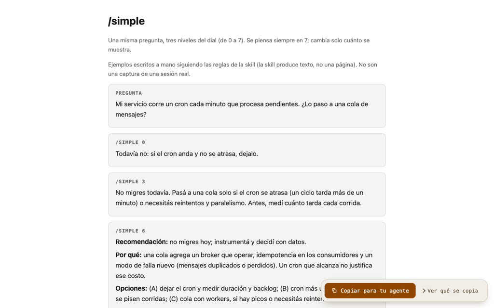
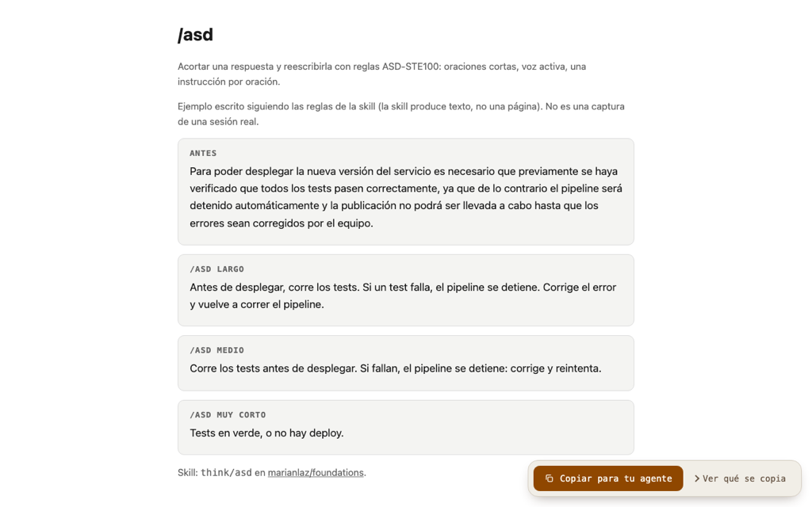
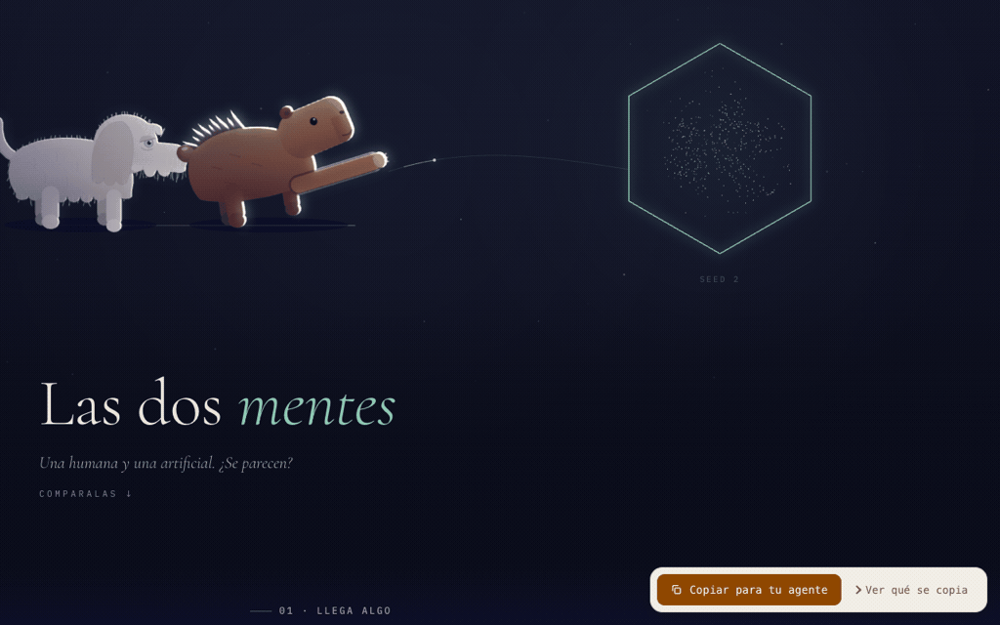
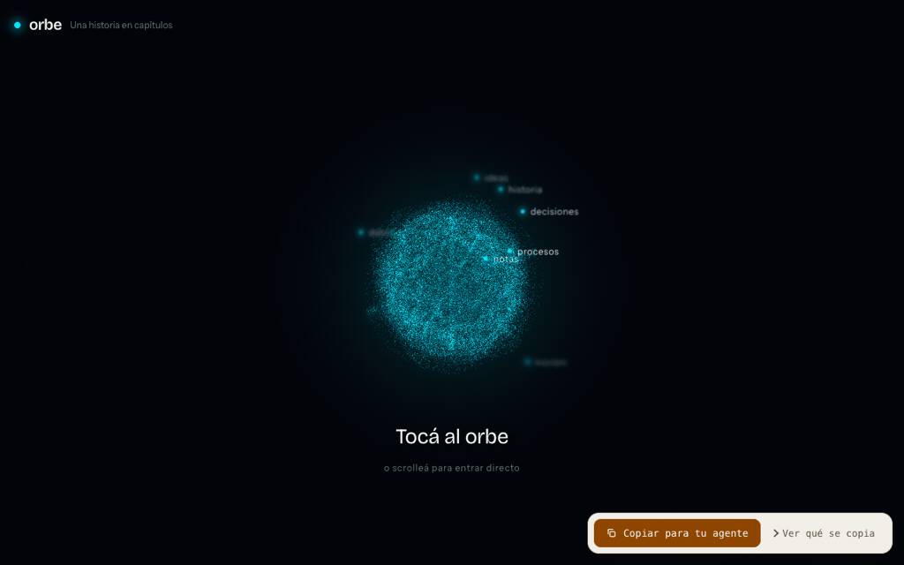
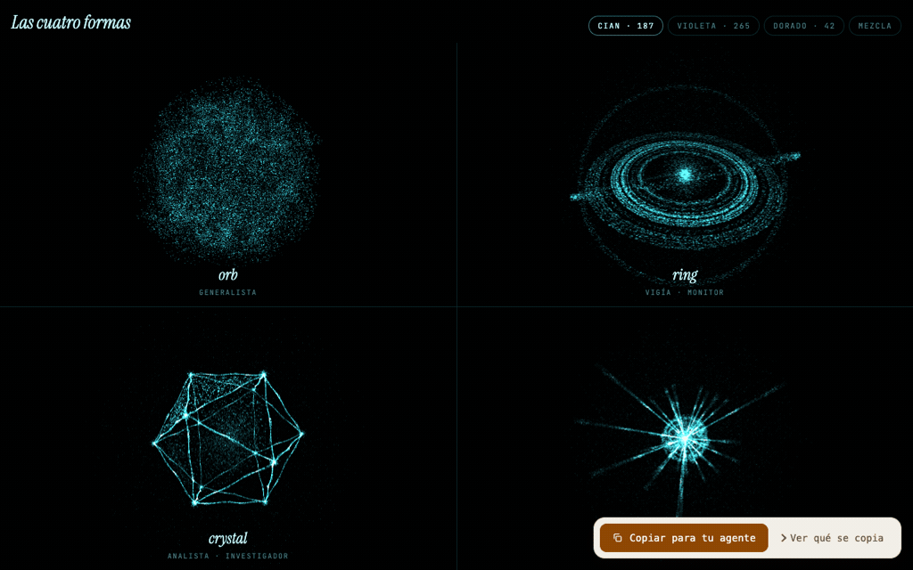

# Foundations

Skills para crear con agentes. Probalas antes de instalarlas.

<table>
<tr>
<td width="50%"><a href="https://marianlaz.github.io/foundations/demos/simple/"></a><br><b>simple</b> · un dial de 0 a 7 para decidir cuánto te cuenta el agente</td>
<td width="50%"><a href="https://marianlaz.github.io/foundations/demos/asd/"></a><br><b>asd</b> · un párrafo hinchado, recortado a lo esencial</td>
</tr>
<tr>
<td width="50%"><a href="https://marianlaz.github.io/foundations/demos/motion-scenes/"></a><br><b>motion-scenes</b> · animaciones dibujadas en código</td>
<td width="50%"><a href="https://marianlaz.github.io/foundations/demos/orb-web/"></a><br><b>orb-web</b> · una web de capítulos sobre un orbe 3D</td>
</tr>
<tr>
<td width="50%"><a href="https://marianlaz.github.io/foundations/demos/forjar-orbe/"></a><br><b>forjar-orbe</b> · las cuatro formas de orbe, en vivo</td>
<td width="50%"></td>
</tr>
</table>

Galería completa: https://marianlaz.github.io/foundations/

## Instalar

```
/plugin marketplace add marianlaz/foundations
/plugin install think@foundations
```

Cambiá `think` por el plugin que quieras. El repo es público, no hace falta nada más.

## Plugins

### think
Cómo pensar y escribir con agentes.
- `simple`: dial de profundidad 0–7. `/simple 3`. ▶ [demo](https://marianlaz.github.io/foundations/demos/simple/)
- `asd`: recorta y reescribe con reglas ASD-STE100. `/asd`. ▶ [demo](https://marianlaz.github.io/foundations/demos/asd/)
- `how-to-work-with-agents`: tips probados para laburar con Claude Code. `/wwa`. demo: pendiente

### episodes
Episodios animados contados por un personaje, en series y con su sala de proyección. Necesita `ELEVENLABS_API_KEY` en el entorno para la voz.
- `episode`: guion, voz y escenas en un `episode.mp4`. demo: pendiente
- `series`: mini serie con arco, sonido y tráiler. demo: pendiente
- `gallery`: sala de proyección privada en claude.ai. demo: pendiente
- `instance`: un personaje nuevo con las mismas skills. demo: pendiente

### visual
Lenguaje visual en código.
- `motion-scenes`: animaciones explicativas en canvas. ▶ [demo](https://marianlaz.github.io/foundations/demos/motion-scenes/)
- `orb-web`: webs de una página sobre un orbe de partículas. ▶ [demo](https://marianlaz.github.io/foundations/demos/orb-web/)
- `video-thumbnails`: thumbnails 16:9 y hero 2:1 desde el contenido real del video. demo: pendiente

### orbs
Orbes del Akasha: capacidades agénticas con forma, color y esencia.
- `forjar-orbe`: de "qué querés que exista" a un orbe, con su motor 3D. ▶ [demo](https://marianlaz.github.io/foundations/demos/forjar-orbe/)
- `buscar-en-el-akasha`, `explicar-akasha`, `derivar-a-una-persona`: las skills del orbe guardián de la memoria (usan el CLI `akasha`). demo: pendiente

## Actualizar

Subimos la `version` del plugin y después `/plugin marketplace update foundations`.

## Cómo funciona esto

El repo es la base de datos. Los demos viven en `docs/demos/` y se sirven con GitHub Pages: lo publicado es espejo directo de lo que ves acá. Los ejemplos de `simple` y `asd` están escritos a mano siguiendo cada skill. «demo: pendiente» quiere decir que todavía no hay uno honesto.

Próximamente: la newsletter Builders.
